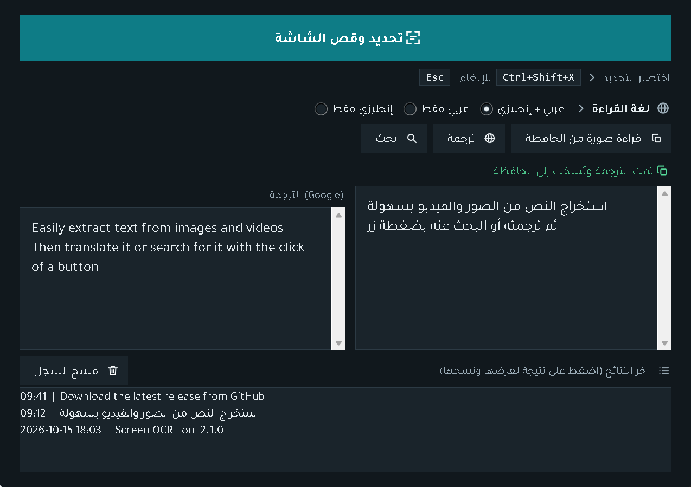
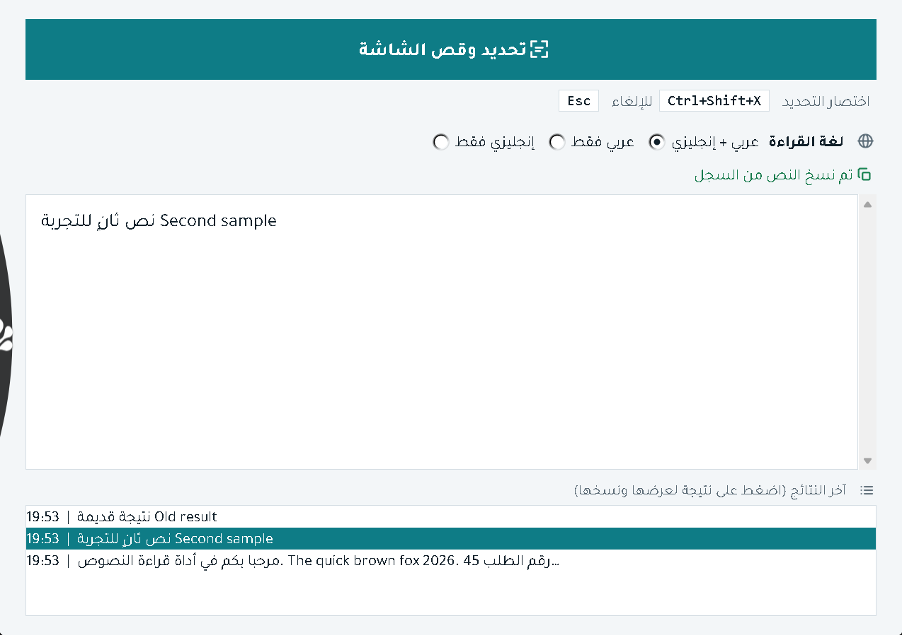
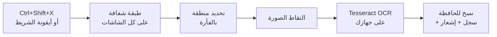
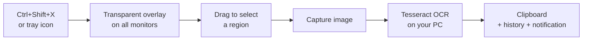

<div align="center">


**[العربية](#-العربية) · [English](#-english)**

### ⬇️ [تنزيل البرنامج (ملف EXE) · Download the app](https://github.com/alimwork85-web/Screen-OCR-Tool/releases/latest)

</div>

---

# 🇸🇦 العربية

## نبذة عن البرنامج

**أداة قراءة النصوص من الشاشة (OCR Tool)** برنامج صغير لنظام Windows يحوّل أي نص تراه على الشاشة إلى نص قابل للنسخ. ضغطة واحدة على `Ctrl+Shift+X`، تحدّد المنطقة بالفأرة، فيُستخرج النص (عربي وإنجليزي) ويُنسخ إلى الحافظة مباشرة، جاهزاً للصق.

مفيد لنسخ نص من صورة، أو ملف PDF ممسوح ضوئياً، أو فيديو، أو برنامج لا يسمح بتحديد النص، أو لقطة شاشة.

القراءة تتم **محلياً على جهازك** عبر محرك Tesseract، ولا يُرسل أي شيء إلى الإنترنت.

<p align="center">
  
  
</p>

## المميزات

| الميزة | التفاصيل |
|---|---|
| ⚡ **اختصار عام** | `Ctrl+Shift+X` يعمل من أي برنامج، و`Esc` للإلغاء |
| 🖥️ **كل الشاشات** | طبقة التحديد تغطي جميع الشاشات المتصلة، حتى الشاشات الموضوعة على يسار الشاشة الرئيسية |
| 🔤 **عربي وإنجليزي** | اختيار لغة القراءة: عربي + إنجليزي، أو عربي فقط، أو إنجليزي فقط (القراءة بلغة واحدة أدق وأسرع) |
| 📋 **نسخ تلقائي** | النص المستخرج يُنسخ إلى الحافظة فور اكتمال القراءة |
| 🕘 **سجل النتائج** | آخر 20 نتيجة، اضغط على أي نتيجة لعرضها ونسخها من جديد (السجل في الذاكرة فقط ويُمسح عند إغلاق البرنامج) |
| 🔔 **يعمل في الخلفية** | يبدأ مخفياً في منطقة الإشعارات (الأيقونات المخفية بجانب الساعة)، بلا نافذة ولا زر في شريط المهام. زر الإغلاق (X) يخفيه ولا ينهيه |
| 🌗 **ثيم فاتح وداكن** | يتبع إعداد Windows ويتبدّل فوراً دون إعادة تشغيل |
| 🧠 **قراءة أذكى** | يصغّر النصوص الكبيرة تلقائياً ويختار أفضل نتيجة، ويعيد المحاولة بوضع مختلف إن لم يجد نصاً |
| 🎨 **واجهة عربية** | تصميم من اليمين لليسار بخط Tajawal المرفق مع البرنامج، وأرقام غربية (0-9) |
| 📐 **يدعم تكبير الشاشة** | يتعامل مع تكبير الشاشة (اختُبر على 150%) |

## كيف يعمل



## طريقة الاستخدام

1. شغّل البرنامج. سيختفي فوراً ويستقر في منطقة الإشعارات (قد تحتاج للضغط على السهم `^` لرؤية الأيقونات المخفية). يظهر إشعار صغير يؤكد أنه جاهز.
2. اضغط `Ctrl+Shift+X` من أي برنامج.
3. اسحب بالفأرة لتحديد المنطقة التي فيها النص. للإلغاء اضغط `Esc`.
4. انتظر لحظة، ثم الصق (`Ctrl+V`) في أي مكان. النص موجود في الحافظة.
5. لفتح النافذة (السجل، اختيار اللغة): انقر على أيقونة الشريط، أو من قائمتها اختر **فتح النافذة**.
6. للخروج نهائياً: قائمة أيقونة الشريط ثم **خروج**.

> ⏳ **ملاحظة:** أول تشغيل لملف EXE جديد قد يستغرق عدة ثوانٍ قبل أن يصبح الاختصار فعّالاً. انتظر ظهور إشعار «يعمل في الخلفية».

## المتطلبات

- نظام **Windows** (اختُبر على Windows 11).
- برنامج **[Tesseract OCR](https://github.com/UB-Mannheim/tesseract/wiki)** (الإصدار 5 مجرَّب) مع حزمتي اللغة **`ara`** و**`eng`**. المسار الافتراضي `C:\Program Files\Tesseract-OCR`، أو أضفه إلى `PATH`.

## التشغيل

**الخيار الأول: ملف EXE الجاهز** (لا يحتاج Python):
نزّل `OCR-Tool-2.0.1.exe` من [صفحة الإصدارات](https://github.com/alimwork85-web/Screen-OCR-Tool/releases/latest) وشغّله. (ما زال يلزمك تثبيت Tesseract، راجع المتطلبات.)

**الخيار الثاني: من الكود المصدري:**

```bash
py -3.14 -m pip install -r requirements.txt
py -3.14 ocr_tool.py
```

**بناء ملف EXE بنفسك:**

```bash
py -3.14 -m PyInstaller --noconfirm ocr_tool.spec
```

الناتج: `dist/ocr_tool.exe` (يحمل رقم الإصدار 2.0.1 وأيقونة التطبيق، ويضم الخط والأيقونات).

**إعادة توليد الأيقونات:**

```bash
py -3.14 tools/make_assets.py
```

## بنية المشروع

```
ocr_tool.py          البرنامج الرئيسي (الواجهة، التحديد، القراءة، الشريط)
ui_icons.py          أيقونات الواجهة (مصدر واحد لصور الواجهة وملفات SVG)
tools/make_assets.py مولّد أيقونة التطبيق وملفات SVG
assets/              الأيقونات (SVG/PNG/ICO) والخطوط
docs/                اللافتة ولقطات الشاشة
ocr_tool.spec        إعدادات بناء PyInstaller
version_info.txt     بيانات إصدار ملف EXE (2.0.1)
requirements.txt     مكتبات Python
```

## استكشاف الأخطاء

| المشكلة | الحل |
|---|---|
| تظهر رسالة «لم يتم العثور على Tesseract» | ثبّت Tesseract وتأكد من وجود `ara` و`eng` في مجلد `tessdata`، أو أضف المسار إلى `PATH` |
| لا أرى النافذة بعد التشغيل | هذا طبيعي. ابحث عن الأيقونة في منطقة الإشعارات (السهم `^`) |
| الاختصار لا يستجيب | انتظر بضع ثوانٍ بعد التشغيل. وقد لا يعمل فوق نوافذ البرامج المشغَّلة كمسؤول (Administrator) |
| النص العربي غير دقيق | اختر «عربي فقط» إن كان النص عربياً. وحدّد منطقة أوضح وأكبر قليلاً |
| يحذّر Windows أو مضاد الفيروسات عند التشغيل | الملف غير موقَّع رقمياً، فقد يظهر تحذير SmartScreen («مزيد من المعلومات» ثم «تشغيل على أي حال»). يمكنك التحقق من سلامة الملف بمقارنة بصمة SHA-256 المذكورة في صفحة الإصدار، أو بناءه بنفسك من الكود |
| ظهرت نسختان من البرنامج | أغلق إحداهما من قائمة الشريط، فالاختصار يجب أن يخص نسخة واحدة |

## حدود معروفة

- يعمل على Windows فقط.
- دقة العربية تتأثر بجودة الصورة ونوع الخط، وهي تعتمد على محرك Tesseract.
- شريط التمرير في صندوق النص يبقى فاتح اللون في الثيم الداكن (مكوّن أصلي من النظام).
- لا يمنع البرنامج تشغيل أكثر من نسخة في الوقت نفسه.

## ما الجديد في الإصدار 2.0.1

- إصلاح أيقونة زر التطبيق في شريط المهام (كانت تظهر ورقة فارغة بدل أيقونة البرنامج).
- خيار تشغيل `--show` لبدء البرنامج بنافذة ظاهرة (مثال: `ocr_tool.exe --show`).

## ما الجديد في الإصدار 2.0.0

- العمل من منطقة الإشعارات، والبدء مخفياً.
- دعم الشاشات المتعددة وتكبير الشاشة.
- اختيار لغة القراءة وسجل آخر النتائج.
- تصميم جديد: ثيم فاتح وداكن، أيقونات، خط Tajawal، وأيقونة جديدة للتطبيق.
- تحسين القراءة: تصغير النص الكبير وإعادة المحاولة.
- إصلاحات: عودة النافذة بعد فشل الالتقاط، منع فتح طبقتي تحديد، عدم تجمّد الواجهة أثناء القراءة، عدم نسخ رسائل الخطأ إلى الحافظة، وعمل `Esc` من أي برنامج.

## الشكر والمصادر

[Tesseract OCR](https://github.com/tesseract-ocr/tesseract) · [Pillow](https://python-pillow.org/) · [pytesseract](https://github.com/madmaze/pytesseract) · [keyboard](https://github.com/boppreh/keyboard) · [pystray](https://github.com/moses-palmer/pystray) · [PyInstaller](https://pyinstaller.org/) · خط [Tajawal](https://fonts.google.com/specimen/Tajawal) برخصة SIL Open Font License (`assets/fonts/OFL-Tajawal.txt`).

## الترخيص

[MIT](LICENSE). مسموح استخدامه وتعديله ومشاركته مع الإبقاء على إشعار الترخيص. الخط Tajawal له ترخيصه الخاص (OFL).

**الوسوم:** #التعرف_الضوئي_على_الحروف #استخراج_النص #قراءة_النصوص #عربي #بايثون #ويندوز #أدوات #OCR #ArabicOCR #Tesseract

---

# 🇬🇧 English

## About

**OCR Tool** is a small Windows app that turns any text you see on screen into copyable text. Press `Ctrl+Shift+X`, drag over the area, and the text (Arabic and English) is extracted and copied to your clipboard, ready to paste.

Handy for text inside images, scanned PDFs, videos, apps that don't let you select text, or screenshots.

Recognition runs **locally on your machine** through the Tesseract engine. Nothing is sent to the internet.

<p align="center">
  
  
</p>

## Features

| Feature | Details |
|---|---|
| ⚡ **Global hotkey** | `Ctrl+Shift+X` works from any app; `Esc` cancels |
| 🖥️ **All monitors** | The selection overlay spans every connected display, including ones placed left of the primary |
| 🔤 **Arabic and English** | Pick the reading language: Arabic + English, Arabic only, or English only (a single language is faster and more accurate) |
| 📋 **Auto copy** | Extracted text goes to the clipboard as soon as it is ready |
| 🕘 **Results history** | The last 20 results; click one to view and copy it again (kept in memory only, cleared on exit) |
| 🔔 **Runs in the background** | Starts hidden in the notification area (the hidden-icons tray by the clock): no window, no taskbar button. The close button (X) hides it instead of quitting |
| 🌗 **Light and dark theme** | Follows the Windows setting and switches live, no restart |
| 🧠 **Smarter reading** | Large text is downscaled automatically and the best result is kept; retries in another mode if nothing is found |
| 🎨 **Arabic-first UI** | Right-to-left layout with the bundled Tajawal font and Western digits (0-9) |
| 📐 **Display scaling** | Handles display scaling (tested at 150%) |

## How it works



## Usage

1. Launch the app. It disappears right away and settles in the notification area (you may need the `^` arrow to see hidden icons). A small notification confirms it is ready.
2. Press `Ctrl+Shift+X` from any app.
3. Drag to select the area containing the text. Press `Esc` to cancel.
4. Wait a moment, then paste (`Ctrl+V`) anywhere. The text is on your clipboard.
5. To open the window (history, language choice): click the tray icon, or choose **فتح النافذة** (Open window) from its menu.
6. To quit completely: tray icon menu, then **خروج** (Exit).

> ⏳ **Note:** the first launch of a freshly built EXE can take several seconds before the hotkey becomes active. Wait for the "running in the background" notification.

## Requirements

- **Windows** (tested on Windows 11).
- **[Tesseract OCR](https://github.com/UB-Mannheim/tesseract/wiki)** (version 5 tested) with the **`ara`** and **`eng`** language packs. Default path `C:\Program Files\Tesseract-OCR`, or put it on `PATH`.

## Running

**Option 1: the prebuilt EXE** (no Python needed):
download `OCR-Tool-2.0.1.exe` from the [releases page](https://github.com/alimwork85-web/Screen-OCR-Tool/releases/latest) and run it. (You still need Tesseract installed, see Requirements.)

**Option 2: from source:**

```bash
py -3.14 -m pip install -r requirements.txt
py -3.14 ocr_tool.py
```

**Build the EXE yourself:**

```bash
py -3.14 -m PyInstaller --noconfirm ocr_tool.spec
```

Output: `dist/ocr_tool.exe` (carries version 2.0.1 and the app icon, with fonts and icons bundled).

**Regenerate the icons:**

```bash
py -3.14 tools/make_assets.py
```

## Project layout

```
ocr_tool.py          main program (UI, selection, OCR, tray)
ui_icons.py          UI icons (one source for UI images and SVG files)
tools/make_assets.py app icon and SVG generator
assets/              icons (SVG/PNG/ICO) and fonts
docs/                banner and screenshots
ocr_tool.spec        PyInstaller build settings
version_info.txt     EXE version metadata (2.0.1)
requirements.txt     Python packages
```

## Troubleshooting

| Problem | Fix |
|---|---|
| "Tesseract not found" message | Install Tesseract and make sure `ara` and `eng` are in its `tessdata` folder, or add it to `PATH` |
| No window after launch | Expected. Look for the icon in the notification area (the `^` arrow) |
| Hotkey does not respond | Wait a few seconds after launch. It may not work over windows running as Administrator |
| Arabic text is inaccurate | Choose "Arabic only" for Arabic text, and select a clearer, slightly larger area |
| Windows or antivirus warns on launch | The file is not code-signed, so SmartScreen may warn ("More info", then "Run anyway"). You can verify it by comparing the SHA-256 hash on the release page, or build it yourself from source |
| Two copies are running | Quit one from the tray menu; the hotkey should belong to a single instance |

## Known limitations

- Windows only.
- Arabic accuracy depends on image quality and font, and on the Tesseract engine.
- The scrollbar in the text box stays light in the dark theme (a native system control).
- The app does not prevent running more than one instance.

## What's new in 2.0.1

- Fixed the taskbar button icon (it showed a blank page instead of the app icon).
- New `--show` launch option to start with the window visible (example: `ocr_tool.exe --show`).

## What's new in 2.0.0

- Runs from the notification area and starts hidden.
- Multi-monitor and display-scaling support.
- Reading-language choice and a recent-results history.
- New design: light and dark themes, icons, the Tajawal font, and a new app icon.
- Better recognition: downscaling large text and a retry mode.
- Fixes: window restored after a failed capture, no double overlays, UI no longer freezes while reading, error messages are not copied to the clipboard, and `Esc` works from any app.

## Credits

[Tesseract OCR](https://github.com/tesseract-ocr/tesseract) · [Pillow](https://python-pillow.org/) · [pytesseract](https://github.com/madmaze/pytesseract) · [keyboard](https://github.com/boppreh/keyboard) · [pystray](https://github.com/moses-palmer/pystray) · [PyInstaller](https://pyinstaller.org/) · [Tajawal](https://fonts.google.com/specimen/Tajawal) font under the SIL Open Font License (`assets/fonts/OFL-Tajawal.txt`).

## License

[MIT](LICENSE). Free to use, modify and share, keeping the license notice. The Tajawal font has its own license (OFL).

**Tags:** #OCR #ArabicOCR #Tesseract #Python #Windows #Tkinter #ScreenshotToText #TextExtraction #Productivity #DarkMode #RTL
