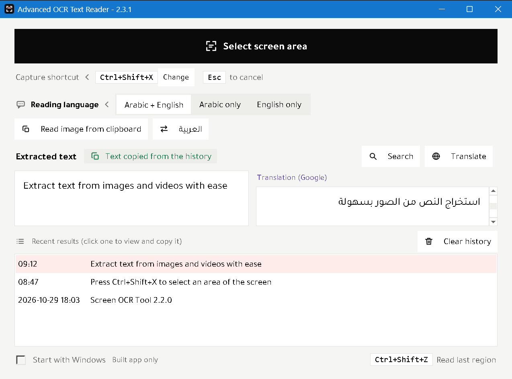
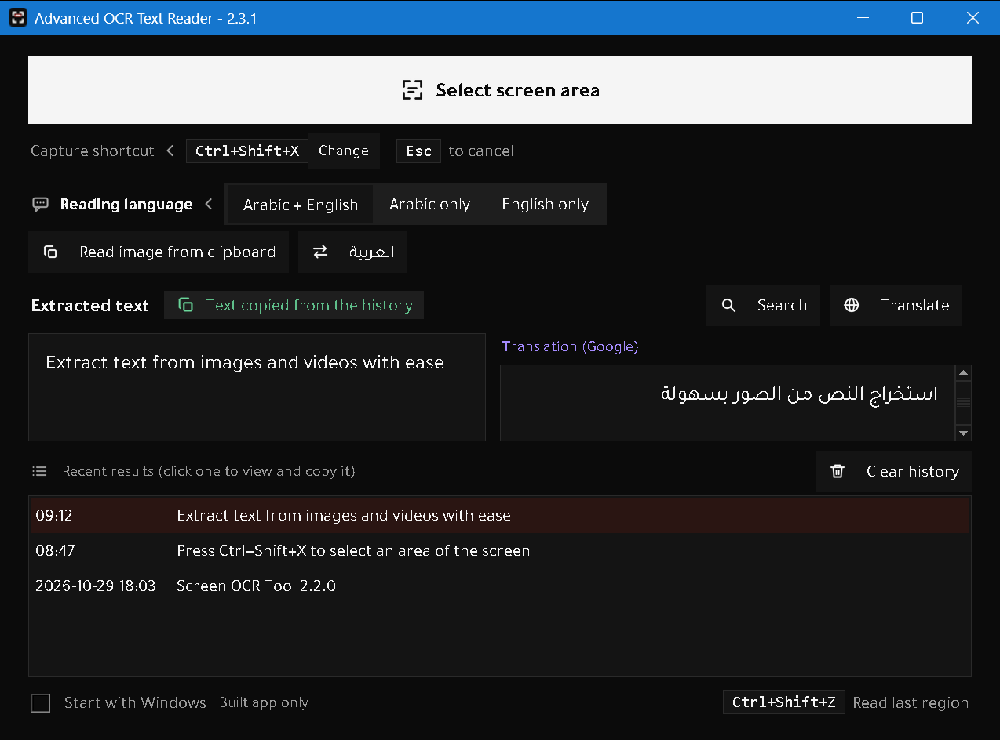
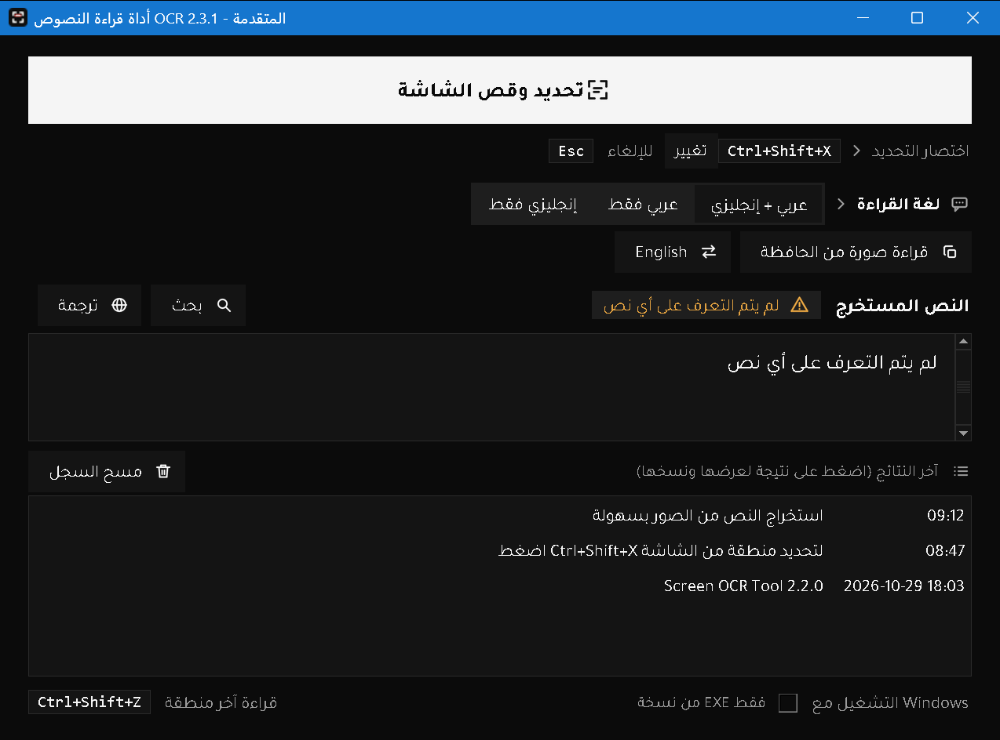
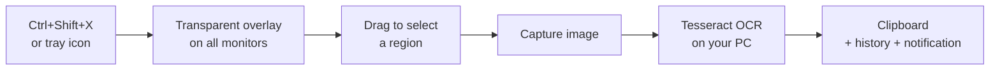
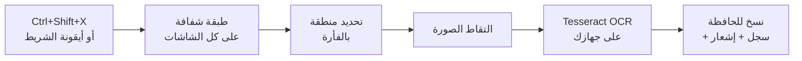

<div align="center">


**[English](#-english) · [العربية](#-العربية)**

### ⬇️ [تنزيل البرنامج (ملف EXE) · Download the app](https://github.com/alimwork85-web/Screen-OCR-Tool/releases/latest)

</div>

---

# 🇬🇧 English

<h2></h2>

**OCR Tool** is a small Windows app that turns any text you see on screen into copyable text. Press `Ctrl+Shift+X`, drag over the area, and the text (Arabic and English) is extracted and copied to your clipboard, ready to paste.

Handy for text inside images, scanned PDFs, videos, apps that don't let you select text, or screenshots.

Recognition runs **locally on your machine** through the Tesseract engine. Text goes online only when you press **Translate** (to Google); without a connection it is translated locally with [Ollama](https://ollama.com) if installed.

<h2></h2>

<p align="center">
  
  
</p>

<p align="center"></p>

<h2></h2>

| Feature | Details |
|---|---|
| ⚡ **Global hotkey** | `Ctrl+Shift+X` works from any app and can be changed with the **Change** button beside it; `Esc` cancels |
| 🖥️ **All monitors** | The selection overlay spans every connected display, including ones placed left of the primary |
| 🔤 **Arabic and English** | Pick the reading language: Arabic + English, Arabic only, or English only (a single language is faster and more accurate) |
| 📋 **Auto copy** | Extracted text goes to the clipboard as soon as it is ready |
| 🌐 **Translate** | The **Translate** button translates the text (Arabic to English, anything else to Arabic) with Google, or locally with Ollama (`gemma3:4b` or the first available model) when offline. The translation appears beside the text and is copied |
| 🔎 **Search** | The **Search** button opens a Google search for the extracted text in your browser |
| ✨ **Selection menu** | Highlight a word or part of the text and three buttons appear right away: Copy, Translate, Search, acting on the highlighted part only |
| 🖼️ **Read from clipboard** | Read the text of a copied image (or an image file copied in Explorer) without selecting the screen, from a button in the window or the tray menu |
| 🔁 **Read last region** | After selecting an area once, `Ctrl+Shift+Z` or **Read last region** in the tray menu reads the same area again without selecting, and it is kept after a restart |
| 🕘 **Results history** | Every result is saved on your machine (`%APPDATA%\OCR_Tool\history.json`) and kept after closing; click one to view and copy it again. Nothing is removed until you press **Clear history** |
| 🔔 **Runs in the background** | Starts hidden in the notification area (the hidden-icons tray by the clock): no window, no taskbar button. The close button (X) hides it instead of quitting |
| 🚀 **Start with Windows** | Starts in the notification area automatically after you sign in to Windows; turn it on or off from the checkbox in the window (built app) |
| 🌗 **Light and dark theme** | Follows the Windows setting and switches live, no restart |
| 🧠 **Smarter reading** | Large text is downscaled automatically and the best result is kept; retries in another mode if nothing is found |
| 💾 **Remembers your settings** | The interface language, the reading language and the rows you collapsed with the arrows stay as you left them between runs |
| 1️⃣ **Single instance** | Launching the app again shows the window of the running copy instead of starting another one |
| 🎨 **Arabic-first UI** | Right-to-left layout with the bundled Tajawal font and Western digits (0-9) |
| 🔁 **Arabic or English UI** | The **English** button switches the interface to a left-to-right English layout (the **العربية** button switches back); the app restarts itself and remembers your choice |
| 📐 **Display scaling** | Handles display scaling (tested at 150%) |

<h2></h2>



<h2></h2>

1. Launch the app. It disappears right away and settles in the notification area (you may need the `^` arrow to see hidden icons). A small notification confirms it is ready.
2. Press `Ctrl+Shift+X` from any app.
3. Drag to select the area containing the text. Press `Esc` to cancel.
4. Wait a moment, then paste (`Ctrl+V`) anywhere. The text is on your clipboard.
5. To open the window (history, language choice): click the tray icon, or choose **فتح النافذة** (Open window) from its menu.
   - To translate or search: press **ترجمة** (Translate) or **بحث** (Search), or highlight part of the text to act on that part only.
   - To read a copied image: press **قراءة صورة من الحافظة** (Read image from clipboard).
6. To quit completely: tray icon menu, then **خروج** (Exit).

> ⏳ **Note:** the first launch of a freshly built EXE can take several seconds before the hotkey becomes active. Wait for the "running in the background" notification.

<h2></h2>

- **Windows** (tested on Windows 11).
- **[Tesseract OCR](https://github.com/UB-Mannheim/tesseract/wiki)** is bundled in the `tesseract` folder with the **`ara`** and **`eng`** language packs, so nothing needs to be installed. When running from source, `vendor/tesseract` is used if present; otherwise `C:\Program Files\Tesseract-OCR` or `PATH`.
- **Optional:** [Ollama](https://ollama.com) with a model such as `gemma3:4b` (`ollama pull gemma3:4b`) for offline translation.

<h2></h2>

<h3></h3>

(no Python needed)
download `OCR-Tool-2.3.1-windows.zip` from the [releases page](https://github.com/alimwork85-web/Screen-OCR-Tool/releases/latest), extract it to any folder, and run `ocr_tool.exe` inside it. (Tesseract is bundled, nothing to install.)

<h3></h3>

```bash
py -3.14 -m pip install -r requirements.txt
py -3.14 ocr_tool.py
```

<h3></h3>

```bash
py -3.14 -m PyInstaller --noconfirm ocr_tool.spec
```

The `vendor/tesseract` folder is tracked in the repository (~72MB), so no local Tesseract is needed. To regenerate it after updating Tesseract on your machine:

```bash
py -3.14 tools/prepare_tesseract.py
```

Output: the `dist/ocr_tool/` folder containing `ocr_tool.exe` (carries version 2.3.1 and the app icon, with fonts and icons bundled). It is built as a folder rather than a single file so it does not unpack into Temp on every launch and leave leftovers behind; move the whole folder, not just the EXE.

**Run the tests:**

```bash
py -3.14 -m pip install pytest
py -3.14 -m pytest
```

**Regenerate the icons:**

```bash
py -3.14 tools/make_assets.py
```

<h2></h2>

```
ocr_tool.py          main program (UI, selection, OCR, tray)
ui_icons.py          UI icons (one source for UI images and SVG files)
translator.py        translation: Google first, then local Ollama
tests/               pytest tests for the OCR pipeline
tools/make_assets.py app icon and SVG generator
assets/              icons (SVG/PNG/ICO) and fonts
docs/                banner and screenshots
ocr_tool.spec        PyInstaller build settings
version_info.txt     EXE version metadata (2.3.1)
requirements.txt     Python packages
```

<h2></h2>

| Problem | Fix |
|---|---|
| "bundled Tesseract was not found" message | The build files are incomplete, extract the full archive again (the `tesseract` folder is required) |
| No window after launch | Expected. Look for the icon in the notification area (the `^` arrow) |
| Hotkey does not respond | Wait a few seconds after launch. It may not work over windows running as Administrator |
| Arabic text is inaccurate | Choose "Arabic only" for Arabic text, and select a clearer, slightly larger area |
| Windows or antivirus warns on launch | The file is not code-signed, so SmartScreen may warn ("More info", then "Run anyway"). You can verify it by comparing the SHA-256 hash on the release page, or build it yourself from source |
| Translation does not work | It needs an internet connection, or Ollama running with a model (e.g. `ollama pull gemma3:4b`). The first local translation can take about 15 seconds while the model loads |
| "language data missing" message | Extract the full archive again; the language packs are bundled in `tesseract\tessdata` |

<h2></h2>

- Windows only.
- Arabic accuracy depends on image quality and font, and on the Tesseract engine.
- Punctuation in lines that mix Arabic and English may look misplaced inside the text boxes (a Tkinter limit), but the copied text is correct.
- Google translation sends the text online, and only when you press Translate.

<h2></h2>

## What's new in 2.3.1

- **Bottom row:** *Start with Windows* now sits below the history, with a *Read last region* hint (`Ctrl+Shift+Z`) at the other end.
- **README:** a new banner, icon section headings and screenshots of the current interface.
- **Chart and social preview:** the performance chart and the repository preview use the new colours.

## What's new in 2.3.0

- **New look:** an ink-and-paper palette in light and dark themes, with one red signal for captured text and violet only for translations.
- **New app icon:** a selection frame with the captured line in red.
- **Result card:** a titled header with a status chip, and the Translate and Search buttons beside it.
- **Reading language:** a segmented selector instead of radio dots.
- **History:** a two-column table (time and text) with a tinted selected row; clicking the selected row copies it again.
- **Selection screen:** a red frame with corner handles, a live size badge and a hint bar.
- **Tray menu:** the actions first with their shortcuts, then Open window and Exit.

## What's new in 2.2.0

- **Start with Windows:** a checkbox adds the app to startup and fixes its path by itself if you move the folder.
- **Changeable capture hotkey:** a Change button beside the shortcut, with no-modifier combinations rejected and `Ctrl+Shift+Z` kept for the last region.
- **Read the last region:** `Ctrl+Shift+Z` or "Read last region" in the tray menu re-reads the last selection without dragging, and it survives restarts.
- **Bundled Tesseract engine:** the app works right after unzipping with no Tesseract install, with the Apache-2.0 notice inside the build.
- **Cleaner UI:** a dedicated icon for the reading-language row and another for the UI-language button, Arabic text aligned right automatically, and scrollbars that follow the dark theme.

## What's new in 2.1.0

- **Translate:** a Translate button using Google, switching automatically to Ollama on your PC when offline. The translation appears beside the text and is copied.
- **Search:** a Search button opens a Google search in your browser.
- **Selection menu:** highlight a word or part of the text to get Copy, Translate and Search for that part only.
- **Read an image from the clipboard:** from a button in the window or the tray menu.
- **History is saved:** it stays after closing until you clear it with the Clear history button.
- **Remembers your settings:** the reading language, plus arrows to collapse the shortcuts row and the language row.
- **Faster:** the two reads (prepared and original image) run in parallel, cutting reading time from 1.07 s to 0.63 s (about 40% faster) with the same result.
- **Single instance:** launching the app again shows the running copy.
- **Startup check:** a clear message when the Arabic or English language pack is missing from the bundled Tesseract.
- Automated tests (pytest) for the OCR pipeline.

<p align="center"></p>

## What's new in 2.0.3

- More accurate reading of text that mixes Arabic, English and numbers: the image is prepared before reading (dark text on a light background even in dark themes, and a suitable size for small and large text), and the more confident of the prepared and original image is picked automatically. In our tests character errors dropped from 17.5% to 10.3%, and reading is faster.
- Removes the invisible direction marks that were copied along with English words and confused pasting.
- Fixes mirrored brackets in Arabic text, e.g. `)476 MB)` → `(476 MB)`.

## What's new in 2.0.2

- The app now ships as a zipped folder instead of a single EXE. The single file unpacked itself into Temp on every launch and left a copy behind (about 65 MB) whenever it was killed or Windows shut down, piling up to gigabytes over time. The new build runs in place, leaves nothing behind, and starts faster.
- If you use a shortcut or start it with Windows, point it to `ocr_tool.exe` inside the new folder. You can delete old `_MEI` folders from `%TEMP%` while the app is closed.

## What's new in 2.0.1

- Fixed the taskbar button icon (it showed a blank page instead of the app icon).
- New `--show` launch option to start with the window visible (example: `ocr_tool.exe --show`).

## What's new in 2.0.0

- Runs from the notification area and starts hidden.
- Multi-monitor and display-scaling support.
- Reading-language choice and a recent-results history.
- New design: light and dark themes, icons, the Tajawal font, and a new app icon.
- Better recognition: downscaling large text and a retry mode.
- Fixes: window restored after a failed capture, no double overlays, UI no longer freezes while reading, error messages are not copied to the clipboard, and `Esc` works from any app.

<h2></h2>

[Tesseract OCR](https://github.com/tesseract-ocr/tesseract) · [Pillow](https://python-pillow.org/) · [pytesseract](https://github.com/madmaze/pytesseract) · [keyboard](https://github.com/boppreh/keyboard) · [pystray](https://github.com/moses-palmer/pystray) · [PyInstaller](https://pyinstaller.org/) · [Tajawal](https://fonts.google.com/specimen/Tajawal) font under the SIL Open Font License (`assets/fonts/OFL-Tajawal.txt`). Tesseract and the bundled language packs are licensed under Apache-2.0 (`THIRD_PARTY_LICENSES.txt`).

<h2></h2>

Developed and published by **Ali Alhumedi**. © 2026 Ali Alhumedi.

[MIT](LICENSE). Free to use, modify and share, keeping the license notice. The Tajawal font has its own license (OFL).

**Tags:** #OCR #ArabicOCR #Tesseract #Python #Windows #Tkinter #ScreenshotToText #TextExtraction #Productivity #DarkMode #RTL #Translation #Ollama

---

# 🇸🇦 العربية

<h2></h2>

**أداة قراءة النصوص من الشاشة (OCR Tool)** برنامج صغير لنظام Windows يحوّل أي نص تراه على الشاشة إلى نص قابل للنسخ. ضغطة واحدة على `Ctrl+Shift+X`، تحدّد المنطقة بالفأرة، فيُستخرج النص (عربي وإنجليزي) ويُنسخ إلى الحافظة مباشرة، جاهزاً للصق.

مفيد لنسخ نص من صورة، أو ملف PDF ممسوح ضوئياً، أو فيديو، أو برنامج لا يسمح بتحديد النص، أو لقطة شاشة.

القراءة تتم **محلياً على جهازك** عبر محرك Tesseract. لا يُرسل النص إلى الإنترنت إلا عند ضغطك زر **ترجمة** (إلى Google)، وإن لم يتوفر الاتصال يُترجم محلياً عبر [Ollama](https://ollama.com) إن كان مثبّتاً.

<h2></h2>

<p align="center">
  
  
</p>

<p align="center"></p>

<h2></h2>

| الميزة | التفاصيل |
|---|---|
| ⚡ **اختصار عام** | `Ctrl+Shift+X` يعمل من أي برنامج، ويمكن تغييره من زر **تغيير** بجانبه، و`Esc` للإلغاء |
| 🖥️ **كل الشاشات** | طبقة التحديد تغطي جميع الشاشات المتصلة، حتى الشاشات الموضوعة على يسار الشاشة الرئيسية |
| 🔤 **عربي وإنجليزي** | اختيار لغة القراءة: عربي + إنجليزي، أو عربي فقط، أو إنجليزي فقط (القراءة بلغة واحدة أدق وأسرع) |
| 📋 **نسخ تلقائي** | النص المستخرج يُنسخ إلى الحافظة فور اكتمال القراءة |
| 🌐 **ترجمة** | زر **ترجمة** يترجم النص (العربي إلى الإنجليزية، وغيره إلى العربية) عبر Google، وإن لم يتوفر الإنترنت يترجم محلياً عبر Ollama (`gemma3:4b` أو أول نموذج متاح). تظهر الترجمة بجانب النص وتُنسخ |
| 🔎 **بحث** | زر **بحث** يفتح بحث Google في المتصفح بالنص المستخرج |
| ✨ **قائمة التظليل** | ظلّل كلمة أو جزءاً من النص بالفأرة فتظهر فوراً ثلاثة أزرار: نسخ، ترجمة، بحث، تعمل على الجزء المظلَّل فقط |
| 🖼️ **قراءة من الحافظة** | اقرأ نص صورة منسوخة (أو ملف صورة منسوخ من المستكشف) دون تحديد الشاشة، من زر في النافذة أو من قائمة أيقونة الشريط |
| 🔁 **قراءة آخر منطقة** | بعد تحديد منطقة مرة واحدة، الاختصار `Ctrl+Shift+Z` أو **قراءة آخر منطقة** في قائمة الأيقونة يقرأ المنطقة نفسها مرة أخرى بلا تحديد، ويبقى محفوظًا بعد إعادة التشغيل |
| 🕘 **سجل النتائج** | كل النتائج محفوظة على جهازك (`%APPDATA%\OCR_Tool\history.json`) وتبقى بعد إغلاق البرنامج، اضغط على أي نتيجة لعرضها ونسخها من جديد. لا يُحذف شيء إلا بزر **مسح السجل** |
| 🔔 **يعمل في الخلفية** | يبدأ مخفياً في منطقة الإشعارات (الأيقونات المخفية بجانب الساعة)، بلا نافذة ولا زر في شريط المهام. زر الإغلاق (X) يخفيه ولا ينهيه |
| 🚀 **التشغيل مع Windows** | يبدأ تلقائياً في منطقة الإشعارات بعد تسجيل الدخول إلى Windows؛ يُفعّل ويُلغى من مربع الاختيار في النافذة (من نسخة EXE) |
| 🌗 **ثيم فاتح وداكن** | يتبع إعداد Windows ويتبدّل فوراً دون إعادة تشغيل |
| 🧠 **قراءة أذكى** | يصغّر النصوص الكبيرة تلقائياً ويختار أفضل نتيجة، ويعيد المحاولة بوضع مختلف إن لم يجد نصاً |
| 💾 **يتذكر إعداداتك** | لغة الواجهة ولغة القراءة والأسطر المطوية بالأسهم تبقى كما تركتها بين التشغيلات |
| 1️⃣ **نسخة واحدة** | تشغيل البرنامج مرة ثانية يُظهر نافذة النسخة المفتوحة بدل تشغيل نسخة أخرى |
| 🎨 **واجهة عربية** | تصميم من اليمين لليسار بخط Tajawal المرفق مع البرنامج، وأرقام غربية (0-9) |
| 🔁 **واجهة عربية أو إنجليزية** | زر **English** يحوّل الواجهة إلى الإنجليزية من اليسار لليمين (وزر **العربية** يعيدها)، ويُعاد تشغيل البرنامج تلقائياً ويتذكر اختيارك |
| 📐 **يدعم تكبير الشاشة** | يتعامل مع تكبير الشاشة (اختُبر على 150%) |

<h2></h2>



<h2></h2>

1. شغّل البرنامج. سيختفي فوراً ويستقر في منطقة الإشعارات (قد تحتاج للضغط على السهم `^` لرؤية الأيقونات المخفية). يظهر إشعار صغير يؤكد أنه جاهز.
2. اضغط `Ctrl+Shift+X` من أي برنامج.
3. اسحب بالفأرة لتحديد المنطقة التي فيها النص. للإلغاء اضغط `Esc`.
4. انتظر لحظة، ثم الصق (`Ctrl+V`) في أي مكان. النص موجود في الحافظة.
5. لفتح النافذة (السجل، اختيار اللغة): انقر على أيقونة الشريط، أو من قائمتها اختر **فتح النافذة**.
   - للترجمة أو البحث: اضغط **ترجمة** أو **بحث**، أو ظلّل جزءاً من النص لتعمل على هذا الجزء فقط.
   - لقراءة صورة منسوخة: اضغط **قراءة صورة من الحافظة**.
6. للخروج نهائياً: قائمة أيقونة الشريط ثم **خروج**.

> ⏳ **ملاحظة:** أول تشغيل لملف EXE جديد قد يستغرق عدة ثوانٍ قبل أن يصبح الاختصار فعّالاً. انتظر ظهور إشعار «يعمل في الخلفية».

<h2></h2>

- نظام **Windows** (اختُبر على Windows 11).
- محرك **[Tesseract OCR](https://github.com/UB-Mannheim/tesseract/wiki)** مرفق مع البرنامج داخل مجلد `tesseract` مع حزمتي اللغة **`ara`** و**`eng`**، فلا تحتاج إلى تثبيته. عند تشغيل الكود المصدري يُستخدم `vendor/tesseract` إن وُجد، وإلا `C:\Program Files\Tesseract-OCR` أو `PATH`.
- **اختياري:** [Ollama](https://ollama.com) مع نموذج مثل `gemma3:4b` (`ollama pull gemma3:4b`) للترجمة دون إنترنت.

<h2></h2>

<h3></h3>

(لا يحتاج Python)
نزّل `OCR-Tool-2.3.1-windows.zip` من [صفحة الإصدارات](https://github.com/alimwork85-web/Screen-OCR-Tool/releases/latest)، وفك ضغطه في أي مجلد، ثم شغّل `ocr_tool.exe` من داخله. (Tesseract مرفق معه، لا تحتاج تثبيت شيء.)

<h3></h3>

```bash
py -3.14 -m pip install -r requirements.txt
py -3.14 ocr_tool.py
```

<h3></h3>

```bash
py -3.14 -m PyInstaller --noconfirm ocr_tool.spec
```

مجلد `vendor/tesseract` مرفوع مع المستودع (~72MB) فلا تحتاج تثبيت Tesseract. لإعادة توليده بعد تحديث Tesseract على جهازك:

```bash
py -3.14 tools/prepare_tesseract.py
```

الناتج: مجلد `dist/ocr_tool/` وفيه `ocr_tool.exe` (يحمل رقم الإصدار 2.3.1 وأيقونة التطبيق، ويضم الخط والأيقونات). يُبنى البرنامج مجلدًا لا ملفًا واحدًا حتى لا يُفك في مجلد Temp عند كل تشغيل فتتراكم بقاياه؛ انقل المجلد كاملًا لا ملف EXE وحده.

**تشغيل الاختبارات:**

```bash
py -3.14 -m pip install pytest
py -3.14 -m pytest
```

**إعادة توليد الأيقونات:**

```bash
py -3.14 tools/make_assets.py
```

<h2></h2>

```
ocr_tool.py          البرنامج الرئيسي (الواجهة، التحديد، القراءة، الشريط)
ui_icons.py          أيقونات الواجهة (مصدر واحد لصور الواجهة وملفات SVG)
translator.py        الترجمة: Google أولاً ثم Ollama محلياً
tests/               اختبارات pytest لمسار القراءة
tools/make_assets.py مولّد أيقونة التطبيق وملفات SVG
assets/              الأيقونات (SVG/PNG/ICO) والخطوط
docs/                اللافتة ولقطات الشاشة
ocr_tool.spec        إعدادات بناء PyInstaller
version_info.txt     بيانات إصدار ملف EXE (2.3.1)
requirements.txt     مكتبات Python
```

<h2></h2>

| المشكلة | الحل |
|---|---|
| تظهر رسالة «لم يتم العثور على Tesseract المرفق» | ملفات البناء ناقصة، أعد فك ضغط البرنامج كاملًا (مجلد `tesseract` مطلوب) |
| لا أرى النافذة بعد التشغيل | هذا طبيعي. ابحث عن الأيقونة في منطقة الإشعارات (السهم `^`) |
| الاختصار لا يستجيب | انتظر بضع ثوانٍ بعد التشغيل. وقد لا يعمل فوق نوافذ البرامج المشغَّلة كمسؤول (Administrator) |
| النص العربي غير دقيق | اختر «عربي فقط» إن كان النص عربياً. وحدّد منطقة أوضح وأكبر قليلاً |
| يحذّر Windows أو مضاد الفيروسات عند التشغيل | الملف غير موقَّع رقمياً، فقد يظهر تحذير SmartScreen («مزيد من المعلومات» ثم «تشغيل على أي حال»). يمكنك التحقق من سلامة الملف بمقارنة بصمة SHA-256 المذكورة في صفحة الإصدار، أو بناءه بنفسك من الكود |
| الترجمة لا تعمل | تحتاج اتصالاً بالإنترنت، أو Ollama يعمل وفيه نموذج (مثل `ollama pull gemma3:4b`). أول ترجمة محلية قد تستغرق نحو 15 ثانية لتحميل النموذج |
| تظهر رسالة «حزمة اللغة ناقصة» | أعد فك ضغط البرنامج كاملًا؛ حزم اللغات مرفقة داخل `tesseract\tessdata` |

<h2></h2>

- يعمل على Windows فقط.
- دقة العربية تتأثر بجودة الصورة ونوع الخط، وهي تعتمد على محرك Tesseract.
- علامات الترقيم في الأسطر التي تخلط العربية بالإنجليزية قد تظهر في غير مكانها داخل مربعات النص (حدود Tkinter)، لكن النص المنسوخ صحيح.
- الترجمة عبر Google ترسل النص إلى الإنترنت، ولا يحدث ذلك إلا عند ضغطك زر الترجمة.

<h2></h2>

## ما الجديد في الإصدار 2.3.1

- **الصف السفلي:** صار «التشغيل مع Windows» تحت السجل، وفي الطرف المقابل تلميح «قراءة آخر منطقة» (`Ctrl+Shift+Z`).
- **README:** شعار جديد وعناوين أقسام بأيقونات ولقطات للواجهة الحالية.
- **الرسم والمعاينة:** رسم الأداء وصورة معاينة المستودع بالألوان الجديدة.

## ما الجديد في الإصدار 2.3.0

- **شكل جديد:** لوحة ألوان بالأسود والورقي في الثيمين الفاتح والداكن، بإشارة حمراء واحدة للنص الملتقَط وبنفسجي للترجمة فقط.
- **أيقونة جديدة للتطبيق:** إطار تحديد وسطر الالتقاط بالأحمر.
- **بطاقة النتيجة:** رأس بعنوان وشارة حالة، وبجانبه زرّا الترجمة والبحث.
- **لغة القراءة:** شريط اختيار مقسّم بدل الدوائر الصغيرة.
- **السجل:** جدول بعمودين (الوقت والنص) وتظليل للصف المختار؛ والضغط على الصف المختار ينسخه من جديد.
- **شاشة التحديد:** إطار أحمر بمقابض في الزوايا وشارة مقاس مباشرة وشريط تلميح.
- **قائمة الإشعارات:** الإجراءات أولاً باختصاراتها، ثم فتح النافذة والخروج.

## ما الجديد في الإصدار 2.2.0

- **التشغيل مع Windows:** مربع اختيار يضيف البرنامج إلى بدء التشغيل، ويصحّح المسار وحده إن نقلت مجلد البرنامج.
- **اختصار الالتقاط قابل للتغيير:** زر «تغيير» بجانب الاختصار، ورفض أي اختصار بلا مفتاح تعديل، وحماية `Ctrl+Shift+Z`.
- **قراءة آخر منطقة:** `Ctrl+Shift+Z` أو عنصر «قراءة آخر منطقة» في قائمة الأيقونة يعيد قراءة آخر تحديد بلا سحب، ويبقى بعد إعادة التشغيل.
- **محرك Tesseract مرفق:** يعمل البرنامج فور فك الضغط دون تثبيت Tesseract، مع ترخيص Apache-2.0 داخل البناء.
- **واجهة أنظف:** أيقونة خاصة لسطر لغة القراءة وأخرى لزر لغة الواجهة، ومحاذاة النص العربي لليمين تلقائياً، وأشرطة تمرير تتبع الثيم الداكن.

## ما الجديد في الإصدار 2.1.0

- **ترجمة:** زر «ترجمة» عبر Google، ويتحول تلقائياً إلى Ollama على جهازك إن انقطع الإنترنت. تظهر الترجمة بجانب النص وتُنسخ.
- **بحث:** زر «بحث» يفتح بحث Google في المتصفح.
- **قائمة التظليل:** ظلّل كلمة أو جزءاً من النص فتظهر: نسخ، ترجمة، بحث، للجزء المظلَّل فقط.
- **قراءة صورة من الحافظة:** من زر في النافذة أو من قائمة الشريط.
- **السجل محفوظ:** يبقى بعد إغلاق البرنامج حتى تمسحه بزر «مسح السجل».
- **يتذكر إعداداتك:** لغة القراءة، وأسهم لطيّ سطر الاختصارات وسطر اللغة.
- **أسرع:** القراءتان (الصورة المهيّأة والأصلية) تعملان معاً، فانخفض زمن القراءة من 1.07 إلى 0.63 ثانية (أسرع بنحو 40%) بالنتيجة نفسها.
- **نسخة واحدة:** تشغيل البرنامج مرة ثانية يُظهر النسخة المفتوحة.
- **فحص عند البدء:** رسالة واضحة إن كانت حزمة اللغة العربية أو الإنجليزية ناقصة من Tesseract المرفق.
- اختبارات تلقائية (pytest) لمسار القراءة.

<p align="center"></p>

## ما الجديد في الإصدار 2.0.3

- قراءة أدق للنصوص التي تخلط العربية بالإنجليزية والأرقام: تُهيّأ الصورة قبل القراءة (نص داكن على خلفية فاتحة حتى في الثيم الداكن، وحجم مناسب للحروف الصغيرة والكبيرة)، ويُختار تلقائياً الأوثق بين الصورة المهيّأة والأصلية. في اختباراتنا انخفضت الأخطاء من 17.5% إلى 10.3% من الأحرف، وصارت القراءة أسرع.
- إزالة علامات الاتجاه غير المرئية التي كانت تُنسخ مع النص الإنجليزي وتربك اللصق.
- تصحيح الأقواس المقلوبة في النص العربي، مثل `)476 ميغابايت)` ← `(476 ميغابايت)`.

## ما الجديد في الإصدار 2.0.2

- يأتي البرنامج مجلدًا مضغوطًا (zip) بدل ملف EXE واحد. كان الملف الواحد يُفك في مجلد Temp عند كل تشغيل، ويترك نسخة منه (نحو 65 ميغابايت) كلما أُغلق قسرًا أو أُطفئ الجهاز، فتتراكم مع الوقت إلى غيغابايتات. النسخة الجديدة تعمل من مكانها ولا تترك شيئًا، وتبدأ أسرع.
- إن كنت تستخدم اختصارًا أو التشغيل مع Windows، فوجّهه إلى `ocr_tool.exe` داخل المجلد الجديد. ويمكنك حذف مجلدات `_MEI` القديمة من `%TEMP%` والبرنامج مغلق.

## ما الجديد في الإصدار 2.0.1

- إصلاح أيقونة زر التطبيق في شريط المهام (كانت تظهر ورقة فارغة بدل أيقونة البرنامج).
- خيار تشغيل `--show` لبدء البرنامج بنافذة ظاهرة (مثال: `ocr_tool.exe --show`).

## ما الجديد في الإصدار 2.0.0

- العمل من منطقة الإشعارات، والبدء مخفياً.
- دعم الشاشات المتعددة وتكبير الشاشة.
- اختيار لغة القراءة وسجل آخر النتائج.
- تصميم جديد: ثيم فاتح وداكن، أيقونات، خط Tajawal، وأيقونة جديدة للتطبيق.
- تحسين القراءة: تصغير النص الكبير وإعادة المحاولة.
- إصلاحات: عودة النافذة بعد فشل الالتقاط، منع فتح طبقتي تحديد، عدم تجمّد الواجهة أثناء القراءة، عدم نسخ رسائل الخطأ إلى الحافظة، وعمل `Esc` من أي برنامج.

<h2></h2>

[Tesseract OCR](https://github.com/tesseract-ocr/tesseract) · [Pillow](https://python-pillow.org/) · [pytesseract](https://github.com/madmaze/pytesseract) · [keyboard](https://github.com/boppreh/keyboard) · [pystray](https://github.com/moses-palmer/pystray) · [PyInstaller](https://pyinstaller.org/) · خط [Tajawal](https://fonts.google.com/specimen/Tajawal) برخصة SIL Open Font License (`assets/fonts/OFL-Tajawal.txt`). تراخيص Tesseract وحزم اللغات المرفقة في `THIRD_PARTY_LICENSES.txt`.

<h2></h2>

المطوّر والناشر: **Ali Alhumedi**. © 2026 Ali Alhumedi.

[MIT](LICENSE). مسموح استخدامه وتعديله ومشاركته مع الإبقاء على إشعار الترخيص. الخط Tajawal له ترخيصه الخاص (OFL).

**الوسوم:** #التعرف_الضوئي_على_الحروف #استخراج_النص #قراءة_النصوص #عربي #بايثون #ويندوز #أدوات #OCR #ArabicOCR #Tesseract #ترجمة #Ollama
